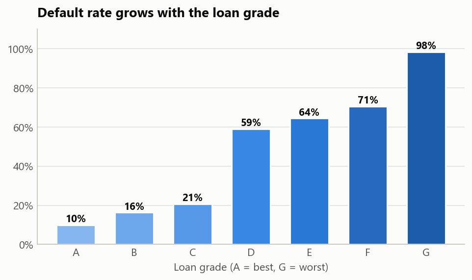
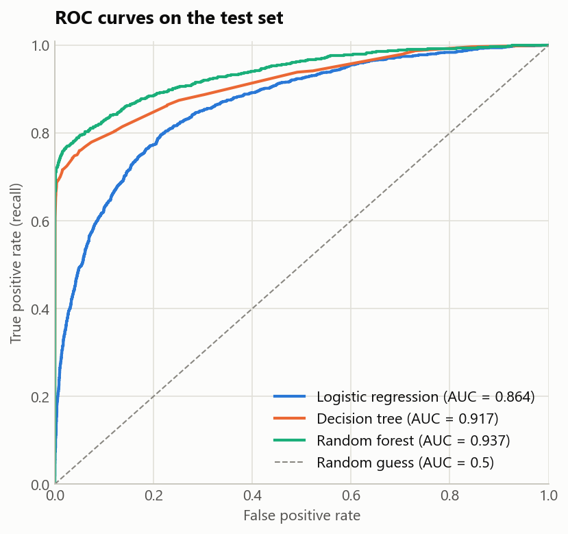
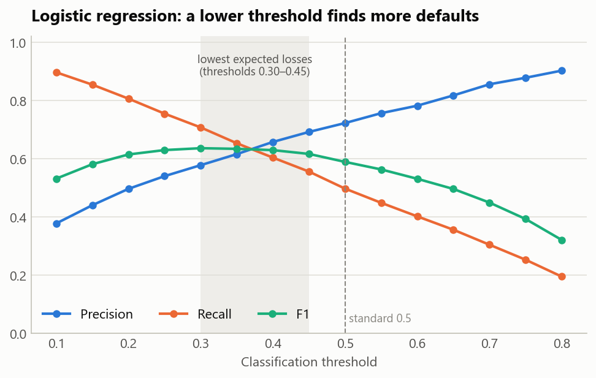

# Credit Risk Model: Predicting Loan Default

**Andrew Andrunin** · Data Analytics / Machine Learning project · November 2026
**Tools:** Python · pandas · matplotlib · seaborn · scikit-learn (logistic regression, decision tree, random forest)

## Context and goal

A bank wants to estimate the probability that a borrower will not repay a loan (default).
The model helps to decide which applications need extra checks.
I built the full cycle: data cleaning, exploratory analysis, feature engineering, a classification model, quality assessment and the choice of a decision threshold for the business.

## Key findings

- **Defaults are 21.8 % of loans**, so this is an imbalanced classification task. Accuracy is misleading here: a model that always says "will repay" already has 78 %.
- **Logistic regression ranks borrowers well (ROC AUC 0.864)** but finds only half of the defaults at the standard 0.5 threshold (recall 0.50, precision 0.72).
- **A lower threshold fits the business better.** A missed default costs much more than a rejected good client. With a rough loss model, the threshold 0.40 gives the lowest losses, and thresholds 0.30–0.45 are almost equal.
- **Random Forest gives the best test results:** ROC AUC 0.937, F1 0.830 (precision 0.972, recall 0.725). It overfits the training data (train AUC 1.000), so the next step is hyperparameter tuning.
- **The strongest risk factors:** loan amount as a share of income, income, loan grade, interest rate and renting a home. The default rate grows from 10 % for grade A to 98 % for grade G.

## Data

[Credit Risk Dataset](../../m16/credit_risk_dataset.csv) — 32,581 borrowers, 12 columns: age, income, home ownership, employment length, loan purpose, loan grade, amount, interest rate, loan-to-income ratio, credit history length, previous default flag and the target `loan_status` (1 = default).

## Approach

1. **Cleaning:** filled missing values with medians (interest rate 9.6 %, employment length 2.7 %), removed impossible values (age 144, employment length 123 years) and 165 duplicates. 32,409 rows remained.
2. **Outliers:** capped income at the IQR upper bound (about 140k) instead of deleting 1,474 high-income borrowers.
3. **EDA:** distributions, default rate by category, correlations with the target.
4. **Features:** ordinal encoding for the loan grade (A < … < G), one-hot encoding for home ownership and loan purpose; 17 features in total.
5. **Model:** stratified 80/20 train/test split, scaling fitted on the training set only, logistic regression.
6. **Evaluation:** confusion matrix, precision, recall, F1, ROC AUC, feature coefficients.
7. **Threshold choice:** precision, recall and F1 for 10 thresholds plus a simple loss estimate (the bank loses 60 % of a defaulted loan; a rejected good client costs 3 years of interest).
8. **Model comparison:** decision tree and random forest on the same split.

## Results

The loan grade is the strongest single signal: the default rate jumps from 21 % for grade C to 59 % for grade D.

| Model (test set, threshold 0.5) | Accuracy  | Precision | Recall    | F1        | ROC AUC   |
| ------------------------------- | --------- | --------- | --------- | --------- | --------- |
| Logistic regression             | 0.848     | 0.722     | 0.497     | 0.589     | 0.864     |
| Decision tree (depth 8)         | 0.926     | 0.947     | 0.700     | 0.805     | 0.917     |
| **Random forest**               | **0.935** | **0.972** | **0.725** | **0.830** | **0.937** |

A lower threshold trades precision for recall. With the threshold 0.35, logistic regression finds 221 more defaults than with 0.5, at the cost of 307 more false alarms. F1 is the highest (0.636) at the threshold 0.3.

## What I would do next

- Tune the random forest (depth, minimum leaf size) with cross-validation to reduce overfitting.
- Try gradient boosting and probability calibration.
- Agree the real costs of errors with the business and choose the threshold on them.

## Files

- [`hw16.2.ipynb`](../../m16/hw16.2.ipynb) — the notebook with code, charts and conclusions (in Ukrainian).
- [`credit_risk_dataset.csv`](../../m16/credit_risk_dataset.csv) — the data.
