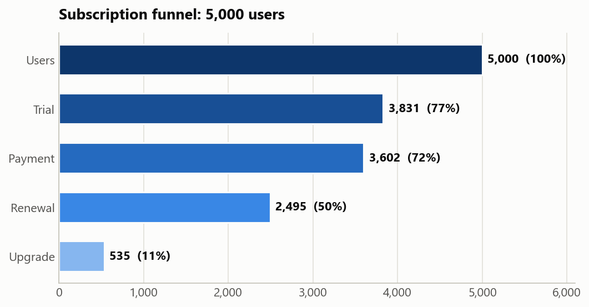
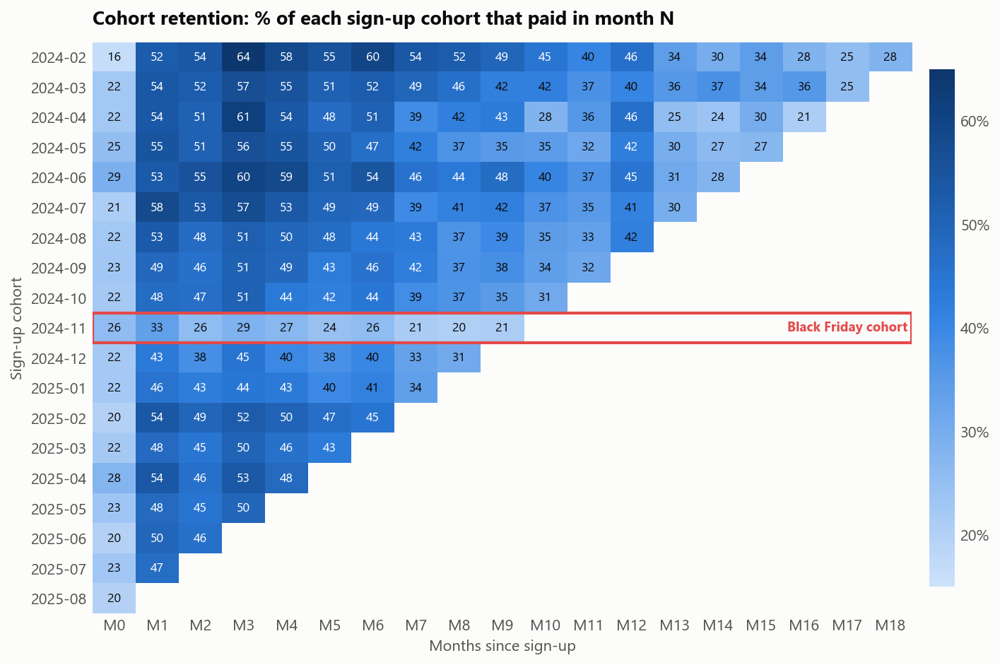
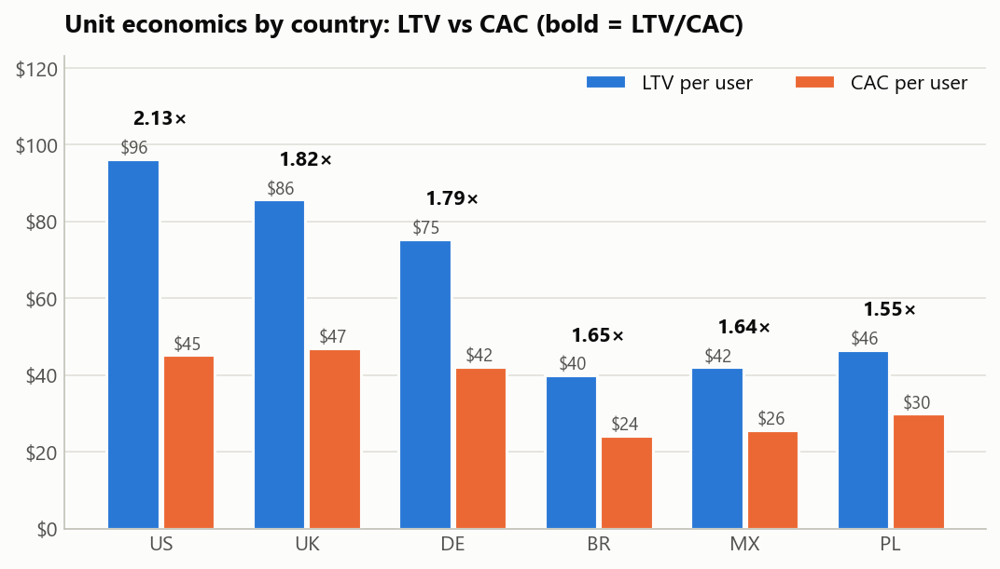
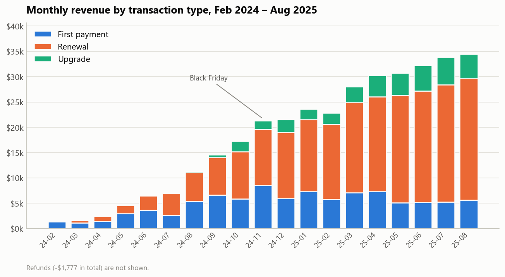

# Subscription App Analysis: Funnel, Retention and Unit Economics

**Andrew Andrunin** · Data Analytics project · June–July 2026
**Tools:** SQL (MySQL) · Excel (Pivot Tables, cohort matrix, calculations) · Python (matplotlib) for charts

## Context and goal

A mobile app for learning English sells subscriptions (weekly trial, monthly, quarterly, annual and lifetime plans).
It launched in February 2024 and grew to 6 countries.
Management had two concerns:

1. Some users finish the free trial but never pay.
2. Nobody knows which acquisition channels pay back and which only spend the budget.

My task was to analyse the subscription funnel and unit economics, find where users drop off, which cohorts and channels are the most valuable, and recommend actions for revenue, retention and marketing.

## Key findings

- **Trial → paid conversion is 64 %.** It depends on the country (from 53 % in MX to 72 % in US, a 19 pp gap), not on the channel (62–67 %, a 5 pp gap). Conversion is a product and pricing issue, not a traffic issue.
- **Upsell is the weakest step.** Only 11 % of users upgrade to a more expensive plan.
- **Every country pays back (LTV/CAC > 1).** The most expensive market, US (CAC $45), has the best payback: LTV/CAC 2.13, because its LTV ($96) is more than twice the LTV in BR or MX.
- **Influencer (6.6×) and TikTok Ads (3.5×) have the best LTV/CAC.** Google Ads brings the largest base of high-value users (LTV $80, 2.8×). Organic and referral users brought $71k at zero acquisition cost.
- **The Black Friday 2024 discount bought volume, not quality.** It brought 25–30 % more paying users than the neighbouring months, but retention fell to 51 % (77 % in October) and average LTV to $87 ($122 in October).

## Data

A synthetic MySQL database provided by DATA LOVES Academy for the course project. The exported tables are in `calculations.xlsx`.

| Table                | Content                                                         | Size        |
| -------------------- | --------------------------------------------------------------- | ----------- |
| `users`              | sign-up date, country, platform, first-touch channel, age group | 5,000 users |
| `transactions`       | trial start, first payment, renewal, upgrade, refund            | 23,020 rows |
| `subscription_plans` | plan, duration, base price                                      | 5 plans     |
| `marketing_spend`    | monthly spend by country and channel                            | 408 rows    |

Period: February 2024 – August 2025 (19 months), 6 countries (US, UK, DE, BR, MX, PL), 7 acquisition channels.
Total revenue: $343.6k. Total marketing spend: $184.5k.

## Approach

1. **SQL:** explored the tables, then built two analysis tables with joins and conditional aggregation: one row per user (funnel flags, payments without trial, revenue) and one row per transaction (plan, country, channel, campaign). See [`queries.sql`](queries.sql).
2. **Excel:** Pivot Tables for the funnel, monthly revenue by transaction type and user segments; a monthly cohort retention matrix; LTV, CAC and LTV/CAC by country and channel (with the "Global" overhead spend allocated to countries).
3. **Deep dives:** Black Friday cohort vs October and December cohorts, the Facebook Ads CAC spike, the "paradox country", channel quality vs volume, refunds and win-back campaigns.
4. **Report** for management with charts and prioritised recommendations.

## Results

### Subscription funnel

77 % of users start a trial and 72 % make a payment (1,150 users pay without a trial). Half of all users renew, but only 11 % upgrade.

### Cohort retention

Month 0 is low (about 23 %) because many users are still on the trial. The first mass payment comes in month 1 (about 50 %). After month 3 the curve flattens: users who stay for three months tend to stay. The Black Friday cohort (2024-11) is the clear outlier with 33 % in month 1.

### Unit economics by country

| Country   | Users     | LTV       | CAC       | LTV/CAC  |
| --------- | --------- | --------- | --------- | -------- |
| US        | 1,300     | $96.3     | $45.2     | 2.13     |
| UK        | 800       | $85.7     | $47.1     | 1.82     |
| DE        | 800       | $75.5     | $42.2     | 1.79     |
| BR        | 1,000     | $39.9     | $24.2     | 1.65     |
| MX        | 650       | $42.0     | $25.7     | 1.64     |
| PL        | 450       | $46.5     | $29.9     | 1.55     |
| **Total** | **5,000** | **$68.5** | **$36.9** | **1.86** |

Cheap traffic in BR (CAC $24) is a trap: it also has the lowest LTV ($40).

### Revenue dynamics

Monthly revenue grew from $1.3k (February 2024) to $34.3k (August 2025). By the end of the period renewals bring about two thirds of revenue, and first payments only about 16 %. The business moves from acquisition to retention of its base.

### Key events

- **Black Friday 2024:** +25–30 % paying users, but the worst retention (51 % vs 77 % in October) and lower LTV per payer ($87 vs $122).
- **EU launch and Facebook Ads:** in May–June 2024 the Facebook CAC doubled from $33 to $66. Spend tripled after the DE and UK launch, but new users only doubled (more expensive markets plus iOS privacy changes). The launch of BR, MX and PL later brought the blended CAC down to $18–23.

## Recommendations

1. **Scale US, UK and DE:** every marketing dollar pays back best there (LTV/CAC 1.8–2.1).
2. **Grow Influencer and TikTok Ads:** the best payback (6.6× and 3.5×) at a moderate volume.
3. **Do not grow BR and MX yet:** unit economics is close to the limit; fix monetisation first, for example with local prices (trial conversion is only 53–56 %).
4. **Develop upsell:** only 11 % upgrade, so this is the cheapest way to raise LTV of existing payers.
5. **Replace deep discounts with promo annual plans:** Black Friday attracts the least loyal users.

## Files

- `queries.sql` — SQL queries used in the analysis.
- `report.pdf` — the full report for management (in Ukrainian).
- `calculations.xlsx` — all calculations: funnel, cohorts, LTV, CAC, deep dives.
